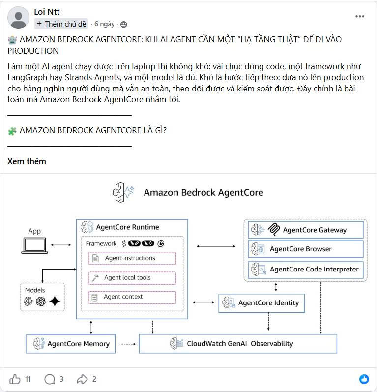

# AMAZON BEDROCK AGENTCORE: THE MISSING INFRASTRUCTURE FOR PRODUCTION AI AGENTS

Getting an AI agent to work on your laptop is easy: a framework like LangGraph or Strands Agents, a model, and a few dozen lines of code. The hard part is what comes next: running it for thousands of users while keeping it secure, observable and under control. That is the problem Amazon Bedrock AgentCore is built to solve.

## What is AgentCore?

AgentCore is an AWS platform for building, deploying and operating agents at scale. It is made of modular services: use them together or pick only the ones you need.

It is also framework- and model-agnostic. It works with CrewAI, LangGraph, LlamaIndex, Google ADK, OpenAI Agents SDK and Strands Agents, and with models outside Amazon Bedrock. You keep your agent code, and AgentCore takes care of the infrastructure around it.

## The main building blocks

| Service | What it does |
|---|---|
| **Runtime** | Serverless hosting for agents and tools. Every user session is isolated, and you pay for the CPU and memory actually used. |
| **Memory** | Short-term (within a conversation) and long-term (across sessions) memory, without building your own storage layer. |
| **Gateway** | Turns APIs, Lambda functions and other services into tools the agent can call. Supports MCP. |
| **Identity** | Lets agents sign in to external systems (Slack, Salesforce, internal APIs) on behalf of a user. Works with Cognito, Entra ID and Okta. |
| **Code Interpreter / Browser** | Run code in a sandbox and interact with websites. |
| **Observability, Evaluations, Policy** | Traces in CloudWatch, quality evaluation, and rules for what the agent may do. |

## The part I like most: Policy

Agents *act*: they call APIs, issue refunds, change data. Telling the model in a prompt to "be careful" is fragile.

Policy moves that control out of the agent. Rules are written in Cedar and enforced at the Gateway. With a Policy Engine in ENFORCE mode, every tool call is checked before it runs, so safety no longer depends on the model behaving well.

## When should you use it?

Use it when you already have a working prototype and now need session isolation, access control and monitoring. For a small demo or a class project, a simple setup is probably enough. AgentCore is built for production scale, and all its services support VPC connectivity, which helps when data must stay private.

## Hands-on: deploy your first agent

This follows the official quickstart using the AgentCore CLI.

**Prerequisites:** an AWS account with credentials configured, Node.js 20.12+, Python 3.10+, and [uv](https://docs.astral.sh/uv/getting-started/installation/).

**1. Install the CLI**

```bash
npm install -g @aws/agentcore
agentcore --version
```

If this prints an error, an old Python `agentcore` command may be shadowing it. Run `pip uninstall bedrock-agentcore-starter-toolkit` and open a new terminal.

**2. Create a project** (a Python agent using Strands Agents and Amazon Bedrock, plus an AgentCore Memory resource)

```bash
agentcore create --name MyProject --template agent-python-strands
cd MyProject
```

**3. Test locally.** This opens a browser inspector where you can chat with the agent and view traces.

```bash
agentcore dev --mode browser
```

**4. Deploy.** The first deploy takes a few minutes because CDK bootstraps your account.

```bash
agentcore build
agentcore deploy
agentcore status
```

**5. Invoke the deployed agent**

```bash
agentcore invoke --runtime agent --payload '{"prompt":"Hello, what can you do?"}'
```

**6. Check logs and traces**

```bash
agentcore logs runtime --since 30m
agentcore traces runtime list --since 30m
```

**7. Clean up** to avoid unexpected charges

```bash
agentcore remove all --yes
agentcore deploy --yes
```

From here, `agentcore add memory`, `agentcore add gateway` and `agentcore add runtime` let you attach more capabilities, followed by another `agentcore deploy`.

## Key takeaways

* The bottleneck for AI agents is no longer the model; it is the infrastructure around it: memory, access, monitoring and control.
* Modular, framework-agnostic services let you move an existing agent to production without rewriting it.
* Enforce what an agent may do at the infrastructure layer (Policy), not only in the prompt.

## References

* [What is Amazon Bedrock AgentCore? (AWS Docs)](https://docs.aws.amazon.com/bedrock-agentcore/latest/devguide/what-is-bedrock-agentcore.html)
* [Amazon Bedrock AgentCore (AWS Prescriptive Guidance)](https://docs.aws.amazon.com/prescriptive-guidance/latest/agentic-ai-frameworks/amazon-bedrock-agentcore.html)
* [Get started with Amazon Bedrock AgentCore (AWS Docs)](https://docs.aws.amazon.com/bedrock-agentcore/latest/devguide/agentcore-get-started-cli.html)


