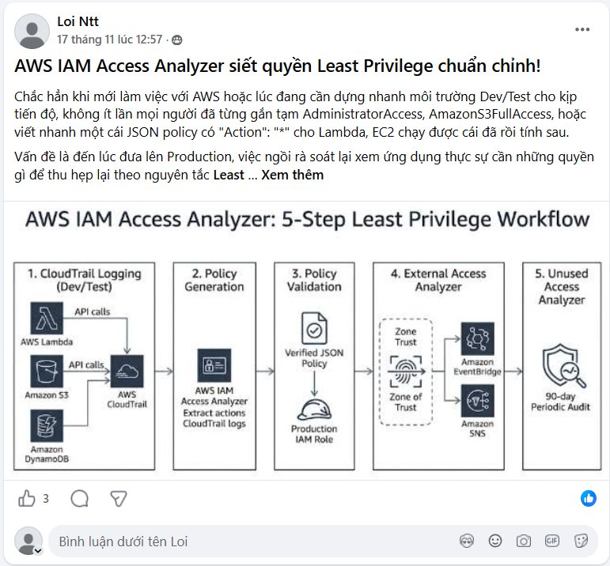

# AWS IAM ACCESS ANALYZER: ENFORCING LEAST PRIVILEGE THE RIGHT WAY

When first working with AWS or rushing to spin up a Dev/Test environment to meet a deadline, most of us have probably attached `AdministratorAccess`, `AmazonS3FullAccess`, or quickly written a JSON policy with `"Action": "*"` just to get Lambda or EC2 running first and worry about permissions later.

The problem comes when moving to Production: manually reviewing which permissions an application actually needs to narrow them down according to the **Least Privilege** principle is very time-consuming. Miss one permission and the app fails with `AccessDenied`; leave too many permissions and you introduce security risks.

Today, I want to share a very useful built-in tool right inside IAM that we sometimes overlook: **AWS IAM Access Analyzer**.

## 1. What is IAM Access Analyzer and why is it different?

Simply put, it is a security auditing toolset that helps you detect resources unintentionally shared externally and refine IAM Policies to follow Least Privilege.

Its standout feature is **Automated Reasoning** — using mathematical logic models to analyze security policies. Instead of waiting for an attacker to access a resource and alerting based on logs, Access Analyzer can mathematically prove with 100% certainty: *"With the current configuration, can an external account read this S3 Bucket or not?"*

## 2. A 5-step workflow to enforce Least Privilege from Dev to Production

Instead of guessing each permission, you can apply this closed-loop 5-step workflow:

### Step 1: Enable a CloudTrail Trail and run tests in Dev/Staging

Attach slightly broader temporary permissions to your application's IAM Role (for example: `ReadWriteProductLambda-DevRole`) so the code runs without permission errors.

**Crucial note:** By default, CloudTrail only logs **Management Events** (such as `CreateTable`, `CreateBucket`). If your code reads/writes files on S3 (`s3:GetObject`, `s3:PutObject`) or manipulates DynamoDB data (`dynamodb:PutItem`, `dynamodb:Query`), you **must** enable **Data Events** in your CloudTrail Trail so Access Analyzer can capture these data-level actions.

Test all features of your app (or run Integration Tests) so every API call is recorded in CloudTrail's S3 logs.

### Step 2: Automatically generate a Policy from CloudTrail history (Policy Generation)

After running tests for a few days, go to **IAM Console → Roles** and open the IAM Role you tested.

Under the **Permissions** tab, scroll down to **Generate policy based on CloudTrail events** and click **Generate policy**.

Select the time range of your tests, choose the corresponding CloudTrail Trail, and wait about 5–15 minutes. The tool scans the logs and produces a draft JSON Policy containing only the exact Actions your application actually called.

### Step 3: Refine ARNs and review with Policy Validation

Open the generated draft and replace `"*"` in the `Resource` field with the specific ARNs of your Production environment.

As you edit the JSON, **Policy Validation** below checks it against more than 100 AWS security rules, flagging red syntax **Errors** or yellow **Security warnings** (such as overly broad `iam:PassRole` permissions). Once you resolve these warnings, you have a clean Policy ready to attach to your Role and can remove the initial `FullAccess` permissions.

### Step 4: Enable External Access Analyzer to guard the perimeter

Go to **Access analyzer → Create analyzer** and choose **External access analysis** with your current account (or AWS Organization) as the **Zone of trust**.

It continuously scans Resource-based policies of S3 Buckets, IAM Roles (Trust Policy), KMS Keys, Lambda, SQS, Secrets Manager, and more. If someone misconfigures a resource and exposes it outside your account, a Finding is immediately generated (which can be routed to Amazon EventBridge → SNS / Slack for alerts).

### Step 5: Review periodically with Unused Access Analyzer (Paid)

As your app evolves over time, some permissions needed in Step 3 may no longer be used. Creating an **Unused access analysis** analyzer (tracking 90 days) helps you detect unused IAM Roles, Access Keys, or permissions so you can remove them periodically ($0.20 per IAM role or user analyzed per month).

## 3. Real-world example

❌ **BEFORE** (While coding in Dev — broad permissions for speed):

```json
{
  "Version": "2012-10-17",
  "Statement": [
    {
      "Effect": "Allow",
      "Action": [
        "dynamodb:*",
        "s3:*"
      ],
      "Resource": "*"
    }
  ]
}
```

✅ **AFTER** (Using Policy Generation from CloudTrail & locking down ARNs for Production):

```json
{
  "Version": "2012-10-17",
  "Statement": [
    {
      "Sid": "LeastPrivilegeDynamoDB",
      "Effect": "Allow",
      "Action": [
        "dynamodb:PutItem",
        "dynamodb:GetItem",
        "dynamodb:UpdateItem"
      ],
      "Resource": "arn:aws:dynamodb:ap-southeast-1:123456789012:table/OrdersTable"
    },
    {
      "Sid": "LeastPrivilegeS3Read",
      "Effect": "Allow",
      "Action": [
        "s3:GetObject"
      ],
      "Resource": "arn:aws:s3:::my-product-catalog-assets/*"
    }
  ]
}
```

## 4. Cost summary

* **100% FREE:** Policy Generation, Policy Validation, and External Access Analyzer are all free (note that enabling CloudTrail Data Events in Step 1 incurs a small CloudTrail charge based on the number of events recorded).
* **Paid:** Only when you enable Unused Access Analyzer or use Custom Policy Checks in CI/CD.

## 5. References

* [Policy generation based on CloudTrail (AWS Docs)](https://docs.aws.amazon.com/IAM/latest/UserGuide/access-analyzer-policy-generation.html)
* [IAM Access Analyzer policy validation (AWS Docs)](https://docs.aws.amazon.com/IAM/latest/UserGuide/access-analyzer-policy-validation.html)
* [IAM Access Analyzer policy check reference (>100 checks)](https://docs.aws.amazon.com/IAM/latest/UserGuide/access-analyzer-reference-policy-checks.html)
* [Security best practices in IAM (Least Privilege)](https://docs.aws.amazon.com/IAM/latest/UserGuide/best-practices.html)

