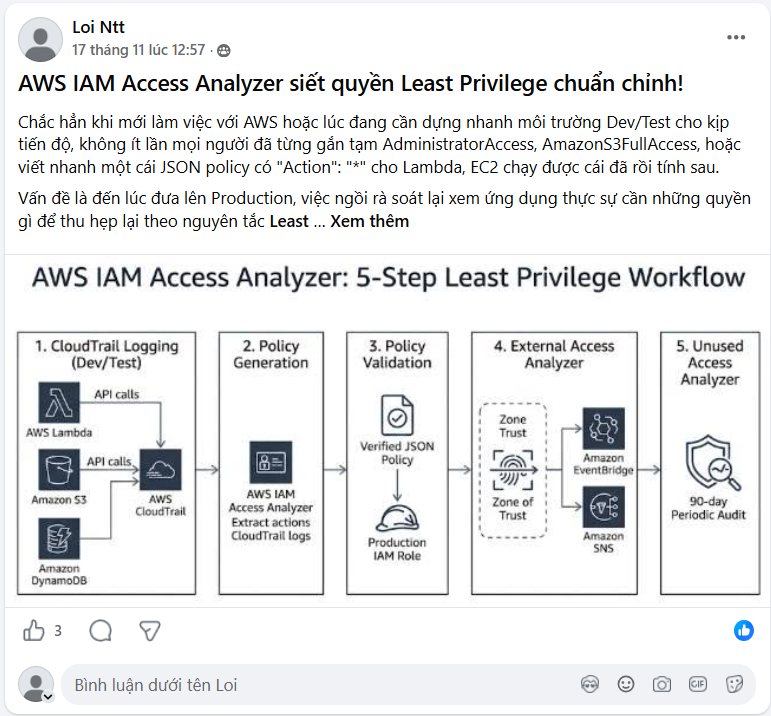

# AWS IAM ACCESS ANALYZER: SIẾT QUYỀN LEAST PRIVILEGE CHUẨN CHỈNH!

Chắc hẳn khi mới làm việc với AWS hoặc lúc đang cần dựng nhanh môi trường Dev/Test cho kịp tiến độ, không ít lần mọi người đã từng gắn tạm `AdministratorAccess`, `AmazonS3FullAccess`, hoặc viết nhanh một cái JSON policy có `"Action": "*"` cho Lambda, EC2 chạy được cái đã rồi tính sau.

Vấn đề là đến lúc đưa lên Production, việc ngồi rà soát lại xem ứng dụng thực sự cần những quyền gì để thu hẹp lại theo nguyên tắc **Least Privilege (Đặc quyền tối thiểu)** thực sự rất tốn thời gian. Thiếu 1 quyền thì app lỗi `AccessDenied`, mà thừa quyền thì lại tiềm ẩn rủi ro bảo mật.

Hôm nay mình muốn chia sẻ với mọi người một công cụ cực kỳ đắc lực có sẵn ngay trong IAM mà đôi khi chúng ta hay bỏ qua: **AWS IAM Access Analyzer**.

## 1. IAM Access Analyzer là gì và tại sao nó khác biệt?

Nói ngắn gọn, đây là bộ công cụ kiểm toán bảo mật giúp bạn phát hiện các tài nguyên đang bị chia sẻ hớ hênh ra bên ngoài và hỗ trợ tinh chỉnh IAM Policy chuẩn Least Privilege.

Điểm ăn tiền nhất của công cụ này là nó sử dụng **Automated Reasoning (Suy luận tự động)** — dùng các mô hình logic toán học để phân tích chính sách bảo mật. Thay vì chờ có kẻ tấn công truy cập vào rồi mới báo động dựa trên log, Access Analyzer có thể khẳng định chính xác 100% về mặt toán học rằng: *"Với cách cấu hình hiện tại, một tài khoản bên ngoài có thể đọc được S3 Bucket này hay không"*.

## 2. Quy trình 5 bước thực hiện Least Privilege từ Dev lên Production

Thay vì ngồi đoán mò từng quyền, mọi người có thể áp dụng quy trình khép kín gồm 5 bước dưới đây:

### Bước 1: Bật CloudTrail Trail và chạy test ở môi trường Dev/Staging

Gắn quyền tạm thời hơi rộng một chút cho IAM Role của ứng dụng (ví dụ: `ReadWriteProductLambda-DevRole`) để code chạy không bị vướng lỗi phân quyền.

**Lưu ý sống còn:** Mặc định CloudTrail chỉ ghi nhận **Management Events** (như `CreateTable`, `CreateBucket`). Nếu code của bạn có đọc/ghi file trên S3 (`s3:GetObject`, `s3:PutObject`) hoặc thao tác dữ liệu DynamoDB (`dynamodb:PutItem`, `dynamodb:Query`), bạn bắt buộc phải bật thêm **Data Events** trong CloudTrail Trail thì Access Analyzer mới quét ra được các action cấp độ dữ liệu này!

Chạy test toàn bộ các tính năng của app (hoặc chạy Integration Test) để mọi lời gọi API đều được lưu vết vào S3 log của CloudTrail.

### Bước 2: Tự động sinh Policy từ lịch sử CloudTrail (Policy Generation)

Sau khi chạy test vài ngày, vào **IAM Console → chọn Roles → mở IAM Role vừa test**.

Ở tab **Permissions**, kéo xuống mục **Generate policy based on CloudTrail events** và nhấn **Generate policy**.

Chọn khoảng thời gian bạn đã chạy test, chọn CloudTrail Trail tương ứng và đợi khoảng 5–15 phút. Công cụ sẽ quét toàn bộ log và trích xuất ra một bản nháp JSON Policy chỉ chứa đúng các Action mà ứng dụng đã thực sự gọi.

### Bước 3: Tinh chỉnh ARN và kiểm duyệt với Policy Validation

Mở bản nháp vừa tạo, thay thế các dấu `"*"` ở phần `Resource` bằng ARN cụ thể của môi trường Production.

Ngay lúc bạn sửa JSON, tính năng **Policy Validation** bên dưới sẽ đối chiếu với hơn 100 quy tắc bảo mật của AWS để báo đỏ các lỗi cú pháp (**Errors**) hoặc cảnh báo vàng (**Security warnings** - như cấp quyền `iam:PassRole` quá rộng). Xử lý hết các cảnh báo này là bạn đã có một bộ Policy sạch đẹp để gắn vào Role, gỡ bỏ các quyền `FullAccess` ban đầu!

### Bước 4: Bật External Access Analyzer canh gác vòng ngoài

Vào mục **Access analyzer → nhấn Create analyzer → chọn External access analysis** với **Zone of trust** là tài khoản hiện tại (hoặc AWS Organization).

Nó sẽ liên tục quét các Resource-based policies của S3 Buckets, IAM Roles (Trust Policy), KMS Keys, Lambda, SQS, Secrets Manager... Nếu có ai cấu hình nhầm làm lộ tài nguyên ra ngoài tài khoản, một Finding sẽ lập tức được tạo ra (có thể bắn thẳng cảnh báo qua Amazon EventBridge → SNS / Slack).

### Bước 5: Rà soát định kỳ với Unused Access Analyzer (Có tính phí)

Khi app chạy lâu dài và thay đổi tính năng, một số quyền từng cần ở Bước 3 có thể không còn dùng tới nữa. Tạo bộ phân tích **Unused access analysis** (theo dõi 90 ngày) sẽ giúp bạn phát hiện các IAM Roles, Access Keys hoặc các quyền bị bỏ quên để cắt bỏ định kỳ ($0.20 / IAM role hoặc user được quét mỗi tháng).

## 3. Ví dụ thực tế

❌ **TRƯỚC** (Lúc đang code trên Dev — cấp quyền rộng cho nhanh):

```json
{
  "Version": "2012-10-17",
  "Statement": [
    {
      "Effect": "Allow",
      "Action": [
        "dynamodb:*",
        "s3:*"
      ],
      "Resource": "*"
    }
  ]
}
```

✅ **SAU** (Khi dùng Policy Generation quét từ CloudTrail & khóa chặt ARN cho Production):

```json
{
  "Version": "2012-10-17",
  "Statement": [
    {
      "Sid": "LeastPrivilegeDynamoDB",
      "Effect": "Allow",
      "Action": [
        "dynamodb:PutItem",
        "dynamodb:GetItem",
        "dynamodb:UpdateItem"
      ],
      "Resource": "arn:aws:dynamodb:ap-southeast-1:123456789012:table/OrdersTable"
    },
    {
      "Sid": "LeastPrivilegeS3Read",
      "Effect": "Allow",
      "Action": [
        "s3:GetObject"
      ],
      "Resource": "arn:aws:s3:::my-product-catalog-assets/*"
    }
  ]
}
```

## 4. Tóm tắt chi phí

* **MIỄN PHÍ 100%:** Cho cả 3 tính năng Policy Generation, Policy Validation và External Access Analyzer (lưu ý nhỏ là nếu bạn bật thêm CloudTrail Data Events ở Bước 1 thì CloudTrail sẽ tính phí nhỏ theo số lượng sự kiện ghi nhận).
* **Tính phí:** Chỉ khi bạn bật Unused Access Analyzer hoặc dùng Custom Policy Checks trong CI/CD.

## 5. Tài liệu tham khảo

* [Hướng dẫn tự động sinh Policy từ CloudTrail (Policy Generation)](https://docs.aws.amazon.com/IAM/latest/UserGuide/access-analyzer-policy-generation.html)
* [Hướng dẫn kiểm tra tính hợp lệ của Policy (Policy Validation)](https://docs.aws.amazon.com/IAM/latest/UserGuide/access-analyzer-policy-validation.html)
* [Danh sách chi tiết >100 quy tắc kiểm duyệt Policy (Policy Check Reference)](https://docs.aws.amazon.com/IAM/latest/UserGuide/access-analyzer-reference-policy-checks.html)
* [AWS Security Best Practices trong IAM (Hướng dẫn chuẩn Least Privilege)](https://docs.aws.amazon.com/IAM/latest/UserGuide/best-practices.html)

