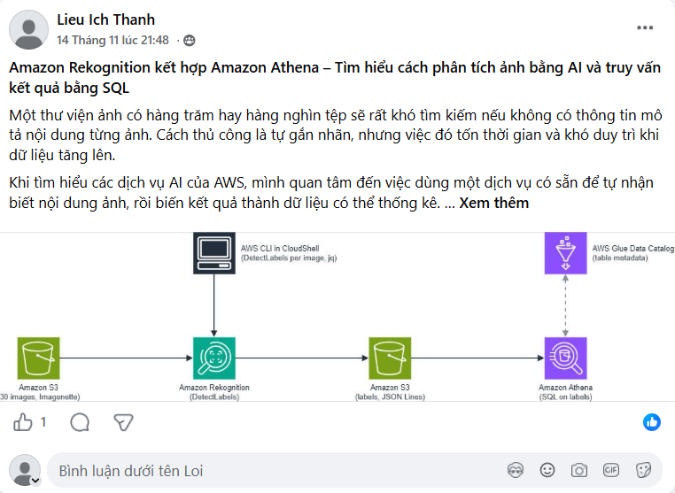

# AMAZON REKOGNITION WITH AMAZON ATHENA – ANALYZING IMAGES WITH AI AND QUERYING RESULTS WITH SQL

An image library with hundreds or thousands of files is very hard to search without descriptions of what is inside each image. Manual tagging works at small scale, but it is time-consuming and difficult to maintain as data grows.

While exploring AWS AI services, I was interested in using a managed service to automatically identify image content, then turning the output into queryable data for analytics. The two services I explored are **Amazon Rekognition** and **Amazon Athena**. Rekognition analyzes images with deep learning and returns descriptive labels, while Athena queries and aggregates those labels using SQL.

## Amazon Rekognition – Image analysis with deep learning

According to AWS documentation, Amazon Rekognition is a deep learning–based image and video analysis service that does not require machine learning expertise to use. It provides simple APIs to analyze images or videos stored in Amazon S3, with capabilities such as detecting objects, text, unsafe content, and faces.

In this post, I use `DetectLabels`, an API that detects objects, scenes, and concepts in JPEG or PNG images. Each returned label includes the label name (`Name`), confidence score from 0 to 100 (`Confidence`), parent labels in the taxonomy (`Parents`), and bounding box locations (`Instances`). The two parameters I use are `MaxLabels` to limit the number of labels and `MinConfidence` to filter out low-confidence labels (default is 55).

Regarding cost, according to the Rekognition pricing page, `DetectLabels` costs $0.001 per image in the first tier ($1.00 per 1,000 images). The Free Tier includes 1,000 images per month for the first 12 months, and running multiple APIs on the same image counts as multiple images.

## Amazon Athena – Querying and aggregating results

Rekognition outputs JSON for each image. To aggregate across many images, I combined the results into JSON lines in S3 and queried them directly with SQL in Athena, similar to how I worked with Athena and Glue Data Catalog. According to the Athena pricing page, queries cost $5 per TB of data scanned.

## How does the Rekognition + Athena workflow work?

I tested a scenario with 30 images from the **Imagenette** dataset (160 px version, Apache-2.0 license), consisting of 3 images for each of 10 classes such as church, garbage truck, gas pump, parachute, and golf ball. I chose this dataset because knowing the ground-truth content makes it easy to verify whether labels are accurate.

* I uploaded the 30 images to S3 and used the AWS CLI to call `DetectLabels` for each image with `MaxLabels` set to `10` and `MinConfidence` set to `80`.
* The results were converted into JSON lines (image, label, confidence, parent labels), merged into a single file, and uploaded to S3.
* I created an external table in Athena pointing to the folder containing that file, then ran SQL queries to aggregate the results.

Results recorded:

* **Total labels:** 166 image–label pairs from 30 images at threshold 80.
* **Top labels:** `Animal` (7 images), `Plant` (5 images), followed by `Gas Pump`, `Grass`, `Machine`, and `Pump` (4 images each), with average confidence around 95 to 97.
* **Filtering by parent label:** filtering images with parent label `Vehicle` returned 3 images.
* **Athena cost:** each query scanned 18.87 KB and ran in about 300 ms.
* **Rekognition cost:** 60 API calls (30 images at two thresholds), within the Free Tier; at list price, about $0.06.

## Confidence and MinConfidence

I ran another pass with `MinConfidence` set to `55` on the same dataset: threshold `80` produced 166 labels (84 unique labels), while threshold `55` produced 243 labels (124 unique labels). A lower threshold returns more labels but may include less accurate ones; a higher threshold returns fewer but more reliable labels. This is the familiar trade-off between recall and precision.

I also did a quick sanity check: each class has exactly 3 images, yet the `Gas Pump` label appeared on 4 images—meaning at least one image from another class was tagged with it—while `Brass Section` appeared on 3 images, matching the 3 French horn images. Therefore, labels should be treated as model predictions and spot-checked in real-world use.

## Notes to keep in mind

* **Cost:** each API call on an image counts as one image, so re-running with a different threshold incurs additional calls.
* **Privacy:** use public datasets or your own images; do not upload other people's photos without consent.
* **IAM:** grant only the required permissions, such as `rekognition:DetectLabels` and read access to the specific S3 prefix.
* **Cleanup:** delete the images, result files in S3, and the Athena table after testing.

## Conclusion

Rekognition and Athena complement each other well when turning image data into structured analytics: Rekognition analyzes images and returns labels with confidence scores without requiring ML expertise, while Athena queries the results with SQL directly on S3 without managing servers. With S3 storing both the raw images and the outputs, you can build a simple pipeline from raw images to summary tables, and later extend it to run automatically whenever new images arrive.

## References

* [What is Amazon Rekognition?](https://docs.aws.amazon.com/rekognition/latest/dg/what-is.html)
* [DetectLabels (Amazon Rekognition API Reference)](https://docs.aws.amazon.com/rekognition/latest/APIReference/API_DetectLabels.html)
* [aws rekognition detect-labels (AWS CLI Command Reference)](https://docs.aws.amazon.com/cli/latest/reference/rekognition/detect-labels.html)
* [Amazon Rekognition Pricing](https://aws.amazon.com/rekognition/pricing/)
* [Imagenette (Hugging Face dataset)](https://huggingface.co/datasets/LibreYOLO/imagenette160)
* [Amazon Athena Pricing](https://aws.amazon.com/athena/pricing/)

