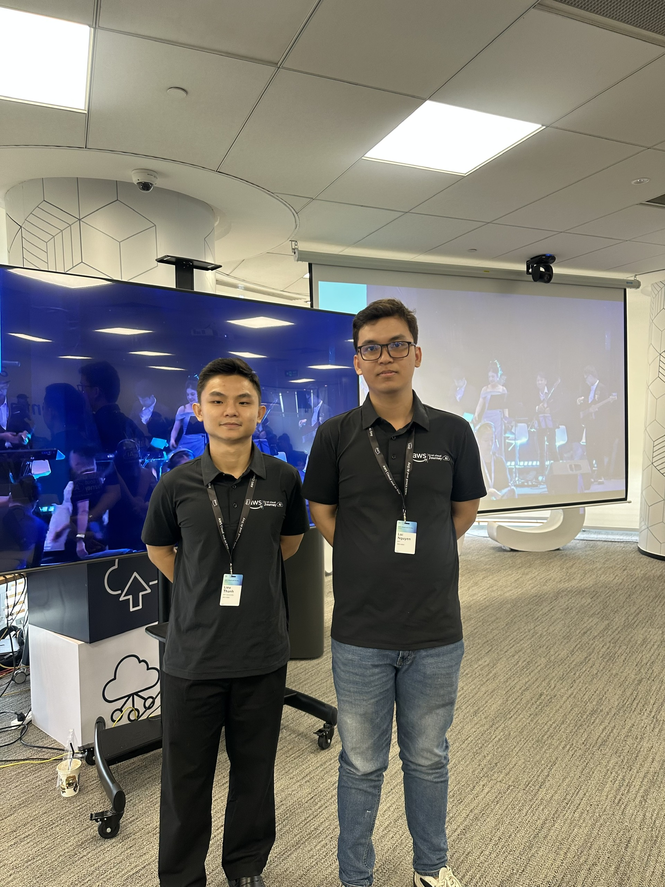

# Summary Report: “AWS Cloud and AI Day Hanoi”

### Event Information

- **Time**: Tuesday, September 26, 2024
- **Location**: 26F, Bitexco Financial Tower, Ho Chi Minh City
- **Organizers**: AWS Viet Nam

### Event Objectives

- Show how enterprises can adopt agentic AI while keeping cost, data and processes under control
- Introduce Amazon Quick and Kiro as a unified AI platform for business and engineering teams
- Present AWS Security Agent for proactive application security from design to deployment
- Introduce MCP and the AWS MCP servers for connecting AI agents to AWS services

### Speakers

- **Tuan Vo** – Sr. Solutions Architect, G-AsiaPacific Vietnam (Session PRT201-S, Level 200)
- **Trung Nguyen** – Technical Account Manager, AWS Vietnam (Session DVT305, Level 300)
- **Tan Huynh** – Technical Account Manager, AWS Vietnam (Session DVT305, Level 300)

### Key Highlights

#### Session 1: Adopt Agentic AI Without Losing Control

**The state of AI adoption in enterprises**

Employees use AI every day, but leadership often does not know what tools are used, how, or where the data goes.

- **Business users**: hard to tap internal data (CRM, customer records), poor automation (manual copy-paste), data governance risk, no audit trail
- **IT / Engineering**: no cost control (no visibility into token spend), no control over outside use (licenses used for personal purposes), cannot measure ROI, processes not standardized
- **Conclusion**: AI is being used, but not yet governed. Enterprises need one unified AI platform to control cost and data while improving productivity.

**Monitor — Control — Standardize**

The core message of the session, applied to both business users and engineers.

**Amazon Quick – Unified AI Agent Platform**

- One platform replacing multiple disconnected tools; available on desktop, web and mobile
- **Enterprise intelligence**: supports on-premises, cloud and SaaS data sources
- **Automation**: plans and executes complex workflows
- **Security & governance**: access control, guardrails, dashboard, audit
- **Extending Quick** (no-code to high-code): Custom Chat Agent, Quick Sight (BI and visualization), Research (in-depth analysis and exportable reports), Amazon Bedrock AgentCore (custom multi-agent systems with security and governance)

**Kiro – Next-Generation IDE for Engineering**

- Available as IDE, CLI and ACP, covering Docs → Build → Package → Deploy → Operate
- **Auto-select**: Kiro picks the optimal model based on task complexity, which keeps cost down
- Models include Claude Opus 5 (complex reasoning, architecture), GPT 5.6 (general purpose, long context), Deepseek v3.2 (code generation, cost-effective), Minimax M2.5 (multilingual, fast inference), GLM 5 (reasoning) and Qwen3 Coder (code-optimized, low cost), plus 12 other models

**Governance & Process Standardization**

- **Governance**: usage dashboard, prompt logs, budget cap and alerts
- **Process**: AI-DLC, spec-driven development, property-based testing
- Goal: move from “using AI” to “governing AI” in software development

**Your Path Forward (3 phases)**

- **Phase 1 – Assess (2–4 weeks)**: audit AI tools in use, find cost leaks, fragmentation and governance gaps, pilot Quick and Kiro with one team on a real use case
- **Phase 2 – Migrate (1–3 months)**: roll out Quick to all business teams, onboard engineers to Kiro across the SDLC, centralize dashboards, budgets and audit logs
- **Phase 3 – Extend (ongoing)**: standardize with spec-driven dev, hooks and AI-DLC, run usage analytics to optimize cost, build custom agents on Bedrock AgentCore
- Motto: *Govern first — Migrate smart — Scale with confidence.*

#### Session 2: AWS Security Agent – Proactive AppSec from Design to Deployment

**Proactive security across the development lifecycle**

- **Design review (minutes)**: evaluates documents against the security baseline requirements
- **Threat model (minutes)**: analyzes application architecture and identifies security threats
- **Code review (near real-time)**: source code security analysis on pull requests, diffs and full repositories
- **Penetration testing (hours)**: discovers and chains validated vulnerabilities through tailored multi-step attack scenarios
- Works wherever applications are built and run: AWS, multicloud, SaaS and hybrid / on-premises

**What is AWS Security Agent?** Context-aware autonomous penetration testing.

- **AI-powered pentesting**: combines SAST, DAST, SCA and autonomous pentesting in one solution
- **Context awareness**: ingests design docs, APIs, IaC, threat models, user stories and endpoints to customize attacks
- **Validated security risks**: chains vulnerabilities into provable, reproducible attacks, reducing false positives and alert fatigue

**Summary of capabilities**

- Threat model is STRIDE-based and auto-generated from the codebase and design documents
- Fully managed by AWS, no infrastructure to set up
- Repository integrations: GitHub, GitLab, Bitbucket and Amazon S3 uploads
- Available in 9 supported regions
- **Pricing**: pay-as-you-go, $50 per agent-hour for penetration testing, metered per second, no upfront cost or minimum commitment
- **Free trial**: 2 months, 400 task-hours per month (included in the AWS Free Tier)

**MCP and AWS MCP servers**

- Agenda: ultrafast refresher on MCP and AWS MCP servers, Agent Toolkit for AWS, supercharging with your knowledge servers, Q&A
- AWS MCP servers: 9,700+ GitHub stars, 60+ servers, 300+ AWS services covered, 20+ community-authored articles

### Key Takeaways

#### Governance Mindset

- AI adoption without visibility creates risks in cost, data and compliance
- **Monitor — Control — Standardize** is the guiding principle
- Start with an assessment and a small pilot before rolling out to the whole organization

#### Technical Architecture

- One unified platform (Quick for business, Kiro for engineering) is better than many disconnected tools
- Auto-selecting models by task complexity balances quality and cost
- Security should be applied at every stage: design, threat modeling, code and testing
- MCP servers let AI agents work with AWS services in a standard way

#### Modernization Strategy

- **Phased roadmap**: Assess → Migrate → Extend
- Measure ROI with usage dashboards, prompt logs and budget caps
- Standardize development with spec-driven development, AI-DLC and property-based testing

### Applying to Work

- **Audit the AI tools** used in my team and project and note the cost and data risks
- **Try Kiro** with spec-driven development in coursework and team projects
- **Use Security Agent ideas** (design review, threat modeling, code review) before deploying a project
- **Experiment with AWS MCP servers** to connect AI assistants to AWS resources
- **Set budget limits and usage tracking** when using AI or cloud services

### Event Experience

Attending **AWS Cloud and AI Day Hanoi** gave me a practical view of how AI is adopted and secured in real organizations.

#### Learning from experienced speakers
- Speakers from G-AsiaPacific and AWS Vietnam shared real problems of enterprise AI adoption and concrete ways to solve them.
- The roadmap and pricing examples made the ideas easy to apply.

#### Hands-on exposure to tools
- Saw how Amazon Quick, Kiro and AWS Security Agent fit into business, development and security workflows.
- Learned that governance (dashboards, logs, budgets) is as important as the AI model itself.

#### Networking and discussions
- Questions during the sessions and conversations with other attendees showed how many teams face the same cost, data and security concerns.

#### Lessons learned
- Control and standardization should come before scaling AI.
- Security works best when it starts at design time, not after deployment.
- Choosing the right model and tool for each task saves both cost and effort.

#### Some event photos

> Overall, the event helped me see AI not only as a productivity tool but as a system that must be monitored, secured and governed.
