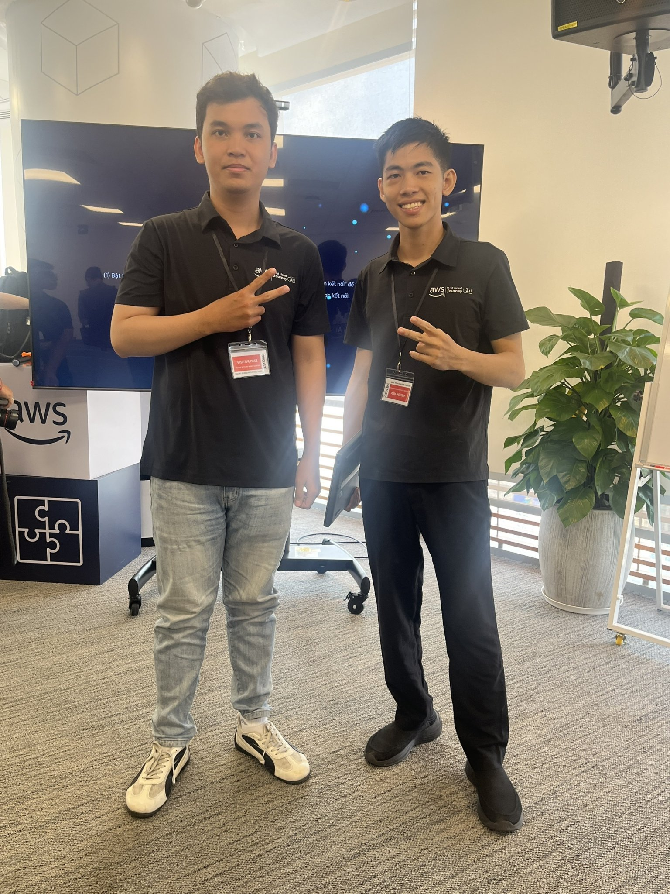

# Summary Report: “FCAJ Meetup – First Cloud AI Journey”

### Event Information

- **Time**: 08:30, Saturday, October 24, 2026
- **Location**: 26F – Bitexco Financial Tower
- **Format**: Meetup for networking and knowledge sharing, counted as one event; registration on the portal

### Event Objectives

- Share practical knowledge on securing web applications with AWS Security Agent
- Explain AI agent concepts and the architecture of Amazon Bedrock AgentCore (Runtime and Memory)
- Introduce Kiro Crew, a persistent AI companion for developers
- Create a space for students and practitioners to exchange ideas

### Speakers

- **Thinh Nguyen** – DevSecOps/Cloud Engineer, Styl Solutions, First Cloud AI Journey
- **Xuan An** – Leader, AWS Student Builder Group HCMUTE
- **Khoa Kieu** – Technical Lead
- **Nghi Danh** – AWS Community Builder

### Key Highlights

#### Session 1: Securing Your Web Apps With AWS Security Agent

**The security bottleneck**

- **Time-consuming**: manual pentests take weeks
- **Expensive**: high daily rates for specialized people
- **Inconsistent**: coverage depends on the pentester's mood and skill
- **High operational costs**: third-party audits cost $5k–$20k per engagement

**Meet the Frontier Agent**

- **Autonomous reasoning**: powered by Amazon Bedrock, it plans and executes security tasks without human intervention
- **Full lifecycle**: covers design review, code security and active penetration testing
- **Verifiable findings**: unlike LLM chatbots, it verifies vulnerabilities by attempting real exploitation

**Three capabilities**

- **Design Security Review**: upload Markdown docs or Terraform code, verify against managed packs (PCI DSS, NIST CSF, AWS Well-Architected), and check whether the design meets security requirements. Free tier: 200 reviews/month
- **Code Security Review**: integrated into GitHub/GitLab pull requests, comments directly on lines of code, suggests valid patches through auto-PR fixes, and scans for vulnerabilities and secrets. Free tier: 1,000 PR reviews/month
- **Automated Pentesting**: an autonomous agent attacks the running application with multi-step exploit chains (for example IDOR → XSS), authenticates like a real user, and provides a detailed attack graph with verifiable proof

#### Session 2: Amazon Bedrock AgentCore – Master Class on Runtime and Memory Architecture

**Agenda**: AI agent / Agentic AI / Agentic system → overview of AgentCore → AgentCore Runtime → AgentCore Memory

**AI agent vs. agentic AI vs. agentic system**

- **AI agent**: a software entity that performs a specific task autonomously within boundaries. Narrow scope, for example a ticket triage bot that classifies support requests and assigns priority
- **Agentic AI**: a broader approach that plans, reasons and coordinates actions toward a goal with limited supervision. For example, a research assistant that plans steps, searches sources, summarizes findings and revises its plan
- **Agentic system**: the actual software architecture that implements agentic AI using agents, tools, memory, orchestration and guardrails. For example, a customer support platform where one agent classifies tickets, another fetches account data, and the system routes, retries, logs and enforces policy

**Challenges in moving agents from prototype to production**

- Agent frameworks (Strands Agents, LangChain, LangGraph, CrewAI) make building easy, but production needs a lot of undifferentiated heavy lifting:
  - Securely executing and scaling agent code
  - Remembering past interactions and learning
  - Identity and access control for agents and tools
  - Agentic tool use for complex workflows
  - Discovering and connecting custom tools and resources
  - Understanding and auditing every interaction

**Amazon Bedrock AgentCore – an all-in-one platform to build, run and optimize agents at scale**

- **Enhance with tools and memory**: Memory, Gateway, Browser tool, Code interpreter
- **Deploy securely at scale**: Runtime, Identity
- **Operational insights**: Observability
- Works with open-source frameworks (CrewAI, Google ADK, LangGraph, LlamaIndex, OpenAI Agents SDK, Strands Agents) and protocols (HTTP, MCP, A2A, AG-UI)

**Ecosystem diagram**: the app and models connect to Agent Runtime (any framework, agent instructions, local tools, context). The runtime works with AgentCore Gateway, Browser, Code Interpreter, Identity and Memory, and everything feeds AgentCore Observability.

#### Session 3: Kiro Crew – All in One Your Companion

**Keep work moving**

- Persistent, open-source dev workspace
- Remembers your context and learns how you work
- Lets you come back to progress, not a restart

**Three pillars**

- **Persistent and self-improving**: memory, lessons and skills carry across sessions
- **Works while you're away**: cron, webhooks and heartbeat monitors
- **8 layers of defense** with signed audit logs

**Control what your crew learns**

- Corrections become durable lessons
- Repeated workflows become named skills (the demo showed 70 skills)
- Plain Markdown: inspect, edit, scope and delete
- Same steering format as the IDE and CLI

**Knowledge graph with search**

- Stores decisions, preferences and project context
- Uses vector embeddings and full-text search
- Retrieves what is relevant, not everything

**Memory that survives restarts**

- Projects and context persist
- Long-running work checkpoints and resumes
- No re-prompting to get back to where you were

### Key Takeaways

#### Security Mindset

- Manual pentesting is slow, costly and inconsistent; AI agents can automate it while keeping proof of every finding
- Security should cover design, code and the running application

#### Agent Architecture

- Distinguish between an agent (one task), agentic AI (goal-driven coordination) and an agentic system (the full architecture)
- Production agents need runtime, identity, memory, tools and observability, not just a framework
- Managed platforms like AgentCore remove much of the repetitive infrastructure work

#### Developer Productivity

- Memory and persistent context mean AI assistants do not start from zero each session
- Lessons and skills stored as plain Markdown stay transparent and controllable
- Autonomous work still needs guardrails and audit logs

### Applying to Work

- **Use AWS Security Agent ideas** to review design docs, Terraform and pull requests in my projects
- **Practice the agent vocabulary** and design my AI projects as agentic systems with clear tools, memory and guardrails
- **Try Bedrock AgentCore** (Runtime, Memory, Gateway) for a small agent prototype
- **Experiment with Kiro Crew** to keep project context and repeated workflows as reusable skills
- **Record decisions and lessons in Markdown** so they can be reused across projects

### Event Experience

Attending the **FCAJ Meetup** at Bitexco Financial Tower was a useful, relaxed event focused on sharing knowledge among students and practitioners.

#### Learning from speakers
- The speakers explained complex topics with simple tables, diagrams and real examples.
- The agent concepts session helped me separate terms I often saw mixed together.

#### Hands-on exposure
- Seeing the Security Agent workflow, the AgentCore ecosystem diagram and the Kiro Crew interface made the tools easier to imagine using.

#### Networking and discussions
- I had the chance to exchange ideas with other students and community members from the AWS Student Builder and Community Builder groups.

#### Lessons learned
- Production-ready AI agents depend as much on memory, identity and observability as on the model.
- Automation is most valuable when its results can be verified and audited.
- Giving users control over what an AI remembers builds trust.

#### Some event photos

> Overall, the meetup gave me a clearer picture of how AI agents are secured, built and kept reliable in real projects.
