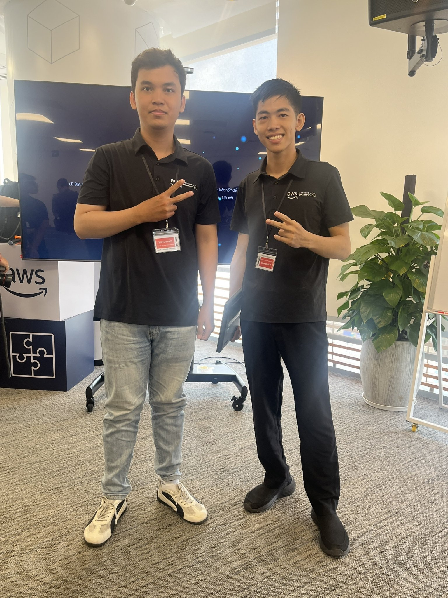

# Bài thu hoạch “FCAJ Meetup – First Cloud AI Journey”

### Thông Tin Sự Kiện

- **Thời gian**: 08:30, thứ Bảy, ngày 24/10/2026
- **Địa điểm**: Tầng 26 – Bitexco Financial Tower
- **Hình thức**: Meetup giao lưu, học hỏi kiến thức, được tính là một buổi event; đăng ký trên portal

### Mục Đích Của Sự Kiện

- Chia sẻ kiến thức thực tế về bảo mật ứng dụng web với AWS Security Agent
- Giải thích các khái niệm AI agent và kiến trúc của Amazon Bedrock AgentCore (Runtime và Memory)
- Giới thiệu Kiro Crew, trợ lý AI bền bỉ dành cho lập trình viên
- Tạo không gian để sinh viên và người làm nghề trao đổi ý tưởng

### Danh Sách Diễn Giả

- **Thinh Nguyen** - DevSecOps/Cloud Engineer, Styl Solutions, First Cloud AI Journey
- **Xuan An** - Leader, AWS Student Builder Group HCMUTE
- **Khoa Kieu** - Technical Lead
- **Nghi Danh** - AWS Community Builder

### Nội Dung Nổi Bật

#### Session 1: Securing Your Web Apps With AWS Security Agent

**Điểm nghẽn của bảo mật**

- **Tốn thời gian**: pentest thủ công mất nhiều tuần
- **Đắt đỏ**: chi phí theo ngày của chuyên gia rất cao
- **Thiếu nhất quán**: độ bao phủ phụ thuộc vào tâm trạng và kỹ năng của pentester
- **Chi phí vận hành cao**: audit bởi bên thứ ba tốn $5k–$20k mỗi lần

**Giới thiệu Frontier Agent**

- **Suy luận tự động**: chạy trên Amazon Bedrock, tự lập kế hoạch và thực thi các tác vụ bảo mật mà không cần con người can thiệp
- **Toàn bộ vòng đời**: bao gồm design review, bảo mật mã nguồn và penetration testing chủ động
- **Kết quả có thể kiểm chứng**: khác với chatbot LLM, nó xác minh lỗ hổng bằng cách thử khai thác thật

**Ba khả năng chính**

- **Design Security Review**: tải lên tài liệu Markdown hoặc code Terraform, đối chiếu với các managed pack (PCI DSS, NIST CSF, AWS Well-Architected) và kiểm tra thiết kế có đáp ứng yêu cầu bảo mật không. Free tier: 200 review/tháng
- **Code Security Review**: tích hợp trực tiếp vào pull request trên GitHub/GitLab, bình luận ngay trên từng dòng code, đề xuất bản vá hợp lệ qua Auto-PR Fixes, quét lỗ hổng và secrets. Free tier: 1.000 PR review/tháng
- **Automated Pentesting**: agent tự động tấn công ứng dụng đang chạy bằng chuỗi khai thác nhiều bước (ví dụ IDOR → XSS), xác thực như người dùng thật, cung cấp attack graph chi tiết và bằng chứng có thể kiểm chứng

#### Session 2: Amazon Bedrock AgentCore – Master Class về kiến trúc Runtime và Memory

**Agenda**: AI agent / Agentic AI / Agentic system → tổng quan AgentCore → AgentCore Runtime → AgentCore Memory

**AI agent, agentic AI và agentic system**

- **AI agent**: thực thể phần mềm thực hiện một tác vụ cụ thể một cách tự động trong giới hạn nhất định. Phạm vi hẹp, ví dụ bot phân loại ticket, phân loại yêu cầu hỗ trợ và gán mức ưu tiên
- **Agentic AI**: cách tiếp cận rộng hơn, biết lập kế hoạch, suy luận và điều phối hành động để đạt mục tiêu với ít giám sát. Ví dụ trợ lý nghiên cứu tự lập các bước, tìm nguồn, tóm tắt kết quả và điều chỉnh kế hoạch
- **Agentic system**: kiến trúc phần mềm thực tế hiện thực hóa agentic AI bằng agents, tools, memory, orchestration và guardrails. Ví dụ nền tảng hỗ trợ khách hàng, nơi một agent phân loại ticket, agent khác lấy dữ liệu tài khoản, còn hệ thống định tuyến, retry, ghi log và thực thi chính sách

**Thách thức khi đưa agent từ prototype lên production**

- Các agent framework (Strands Agents, LangChain, LangGraph, CrewAI) giúp xây dựng dễ dàng, nhưng production cần rất nhiều công việc nặng nhọc không tạo khác biệt:
  - Thực thi và mở rộng code của agent một cách an toàn
  - Ghi nhớ các tương tác trước đó và học hỏi
  - Quản lý danh tính và quyền truy cập cho agent và tool
  - Dùng tool theo kiểu agentic cho các workflow phức tạp
  - Khám phá và kết nối các tool, tài nguyên tùy chỉnh
  - Hiểu và audit mọi tương tác

**Amazon Bedrock AgentCore – nền tảng all-in-one để xây dựng, vận hành và tối ưu agent ở quy mô lớn**

- **Tăng cường bằng tools và memory**: Memory, Gateway, Browser tool, Code interpreter
- **Triển khai an toàn ở quy mô lớn**: Runtime, Identity
- **Thông tin vận hành**: Observability
- Hoạt động với các framework mã nguồn mở (CrewAI, Google ADK, LangGraph, LlamaIndex, OpenAI Agents SDK, Strands Agents) và các giao thức (HTTP, MCP, A2A, AG-UI)

**Sơ đồ hệ sinh thái**: ứng dụng và các model kết nối với Agent Runtime (bất kỳ framework, agent instructions, local tools, context). Runtime làm việc với AgentCore Gateway, Browser, Code Interpreter, Identity và Memory, và mọi thành phần đều đẩy dữ liệu về AgentCore Observability.

#### Session 3: Kiro Crew – All in One Your Companion

**Giữ công việc luôn tiến triển**

- Workspace phát triển mã nguồn mở, bền bỉ
- Nhớ ngữ cảnh của bạn và học cách bạn làm việc
- Quay lại là tiếp tục tiến độ, không phải bắt đầu lại

**Ba trụ cột**

- **Bền bỉ và tự cải thiện**: memory, bài học và kỹ năng được giữ qua các phiên làm việc
- **Làm việc khi bạn vắng mặt**: cron, webhook và heartbeat monitor
- **8 lớp phòng thủ** cùng audit log có chữ ký

**Kiểm soát những gì crew học được**

- Các lần sửa lỗi trở thành bài học lâu dài
- Workflow lặp lại trở thành skill có tên (bản demo hiển thị 70 skill)
- Markdown thuần: xem, chỉnh sửa, giới hạn phạm vi và xóa
- Cùng định dạng steering với IDE và CLI

**Knowledge graph có tìm kiếm**

- Lưu quyết định, sở thích và ngữ cảnh dự án
- Dùng vector embeddings kết hợp full-text search
- Truy xuất phần liên quan, không phải mọi thứ

**Memory tồn tại qua các lần khởi động lại**

- Dự án và ngữ cảnh được giữ nguyên
- Công việc dài hạn có checkpoint và có thể tiếp tục
- Không cần prompt lại để quay về chỗ đang làm dở

### Những Gì Học Được

#### Tư Duy Bảo Mật

- Pentest thủ công chậm, tốn kém và thiếu nhất quán; AI agent có thể tự động hóa nhưng vẫn giữ bằng chứng cho từng phát hiện
- Bảo mật cần bao phủ cả thiết kế, mã nguồn và ứng dụng đang chạy

#### Kiến Trúc Agent

- Phân biệt agent (một tác vụ), agentic AI (điều phối theo mục tiêu) và agentic system (toàn bộ kiến trúc)
- Agent production cần runtime, identity, memory, tools và observability, không chỉ một framework
- Nền tảng được quản lý như AgentCore giúp loại bỏ nhiều công việc hạ tầng lặp lại

#### Năng Suất Lập Trình

- Memory và ngữ cảnh bền bỉ giúp trợ lý AI không phải bắt đầu từ đầu mỗi phiên
- Bài học và skill lưu bằng Markdown thuần giúp minh bạch và dễ kiểm soát
- Công việc tự động vẫn cần guardrails và audit log

### Ứng Dụng Vào Công Việc

- **Áp dụng ý tưởng của AWS Security Agent** để review tài liệu thiết kế, Terraform và pull request trong các project
- **Dùng đúng thuật ngữ agent** và thiết kế các project AI như agentic system với tools, memory và guardrails rõ ràng
- **Thử Bedrock AgentCore** (Runtime, Memory, Gateway) cho một prototype agent nhỏ
- **Thử Kiro Crew** để giữ ngữ cảnh dự án và biến workflow lặp lại thành skill tái sử dụng
- **Ghi lại quyết định và bài học bằng Markdown** để dùng lại giữa các project

### Trải nghiệm trong event

Tham gia **FCAJ Meetup** tại Bitexco Financial Tower là một trải nghiệm bổ ích và thoải mái, tập trung vào việc chia sẻ kiến thức giữa sinh viên và người làm nghề.

#### Học hỏi từ các diễn giả
- Các diễn giả giải thích những chủ đề phức tạp bằng bảng, sơ đồ đơn giản và ví dụ thực tế.
- Phần khái niệm về agent giúp tôi phân biệt rõ các thuật ngữ mà trước đây hay bị dùng lẫn lộn.

#### Trải nghiệm thực tế
- Việc xem quy trình của Security Agent, sơ đồ hệ sinh thái AgentCore và giao diện Kiro Crew giúp tôi hình dung dễ hơn cách sử dụng các công cụ này.

#### Kết nối và trao đổi
- Tôi có cơ hội trao đổi ý tưởng với các bạn sinh viên và thành viên cộng đồng từ AWS Student Builder Group và Community Builder.

#### Bài học rút ra
- AI agent sẵn sàng cho production phụ thuộc vào memory, identity và observability không kém gì bản thân model.
- Tự động hóa có giá trị nhất khi kết quả có thể được kiểm chứng và audit.
- Cho người dùng quyền kiểm soát những gì AI ghi nhớ sẽ tạo thêm sự tin tưởng.

#### Một số hình ảnh khi tham gia sự kiện

> Tổng thể, buổi meetup giúp tôi hiểu rõ hơn cách AI agent được bảo mật, xây dựng và giữ ổn định trong các dự án thực tế.
