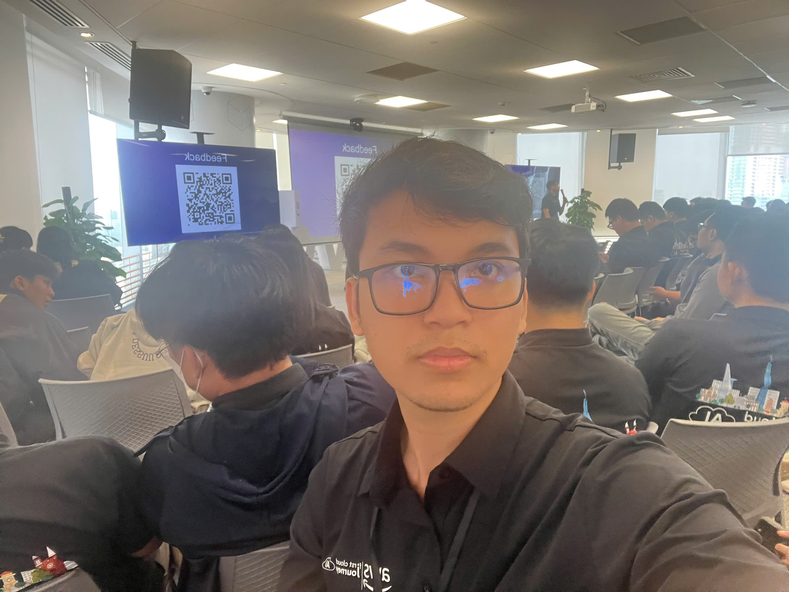

# Bài thu hoạch “FPT University Workshop – From Prototype to Production”

### Thông Tin Sự Kiện

- **Sự kiện**: FPT University Workshop, do First Cloud AI Journey (FCAJ) tổ chức
- **Chủ đề**: Enterprise AI an toàn, đáng tin cậy và có khả năng mở rộng trên cloud
- **Hình thức**: Workshop gồm hai phần chính: đưa AI từ prototype lên production, và các case study

### Mục Đích Của Sự Kiện

- Giải thích khoảng cách giữa một prototype AI trong học thuật và một hệ thống enterprise AI
- Trình bày bốn trụ cột của AI production (bảo mật, khả năng mở rộng, độ tin cậy và chi phí) và cách cloud hỗ trợ chúng
- Học từ các case study thực tế: Cox Automotive, Mobileye và Duolingo
- Giới thiệu Amazon Bedrock AgentCore như nền tảng để vận hành agent trong doanh nghiệp

### Danh Sách Diễn Giả

- **Khang Duong** - FCAJ member
- **Phuong Huyen** - AI Engineer Fresher, FPT Software
- **Nguyen Lam Anh** - AI Engineer, FCAJ

### Nội Dung Nổi Bật

#### Session 1: From Prototype to Production – Secure, Reliable, Scalable Enterprise AI on the Cloud

**Một nhà hàng, một câu chuyện**

Diễn giả dùng phép ví von nhà hàng xuyên suốt buổi chia sẻ:

- **Prototype** = bếp nhà
- **Enterprise AI** = chuỗi nhà hàng
- **Cloud** = bếp trung tâm

**AI trong doanh nghiệp**

- Luồng xử lý là Data (nguyên liệu) → AI model (đầu bếp) → Feature (món ăn) → Users (khách hàng)
- AI thường là một tính năng bên trong sản phẩm, ví dụ gợi ý sản phẩm, chatbot hỗ trợ hoặc phát hiện gian lận

**AI học thuật và enterprise AI**

| Khía cạnh | Academic AI (bếp nhà) | Enterprise AI (chuỗi nhà hàng) |
|---|---|---|
| Mục tiêu | Độ chính xác | Giá trị kinh doanh |
| Dữ liệu | Bộ dữ liệu sạch, cố định | Dữ liệu thật, luôn thay đổi |
| Người dùng | Một vài người | Hàng triệu người dùng |
| Vận hành | Chạy một lần | 24/7, không gián đoạn |

**Không chỉ là một model**

- Model chỉ là “công thức nấu ăn”. Một hệ thống production còn cần data pipeline, bảo mật, khả năng mở rộng, độ tin cậy, giám sát và kiểm soát chi phí
- **Elastic scalability**: bếp cố định lãng phí khi ít khách và quá tải khi đông khách, còn bếp co giãn thay đổi theo nhu cầu. Trên AWS, Lambda tự nhân bản, Auto Scaling thêm hoặc bớt tài nguyên, và Load Balancer chia đều tải
- **Reliability**: một lò nướng hỏng thì lò dự phòng sẵn sàng. Các công cụ gồm health check, retry, failover và alarm
- **Cost efficiency**: không chạy mọi thứ khi không có ai dùng. Dùng pay-per-use, right-size và caching

**Vai trò của cloud**

- Bảo mật tích hợp sẵn, mở rộng theo nhu cầu, các vùng dự phòng cho độ tin cậy và trả tiền theo mức dùng
- Trách nhiệm được chia rõ: AWS quản lý hạ tầng, còn bạn quản lý dữ liệu và cách sử dụng

#### Session 2: From Prototype to Production – Case Study

**Cox Automotive**

- Hơn 29.000 nhân viên trên năm châu lục, 2,3 tỷ tương tác trực tuyến mỗi năm (first-party data) và 57 cơ hội agentic AI đã được xác định
- Lĩnh vực: mua bán xe, đấu giá, phần mềm cho đại lý và dịch vụ quản lý đội xe
- Câu hỏi chính: “Làm thế nào để xây dựng các giải pháp AI tự động mà người dùng tin tưởng?”
- Cách tiếp cận: chuẩn hóa nền tảng trước với Amazon Bedrock AgentCore
  - **AgentCore Runtime**: một runtime chung cho mọi agent, bao gồm triển khai, giám sát, xử lý lỗi và các mẫu bảo mật; chạy các hệ thống multi-agent của Strands
  - **AgentCore Identity**: quyền chi tiết theo vai trò cho từng agent
  - **Amazon Bedrock Guardrails**: kiểm tra đầu vào và đầu ra, bảo mật nhiều lớp cùng prompt hardening
  - **AgentCore Memory**: ngữ cảnh xuyên suốt các phiên và sở thích của khách hàng
  - **AgentCore Observability**: ghi log mọi tương tác để gỡ lỗi quá trình suy luận nhiều bước

**Mobileye**

- Các kỹ sư giỏi phải dành thời gian trả lời ticket trạng thái: 66% ticket hỗ trợ là câu hỏi trạng thái thông thường, và mỗi ticket mất khoảng 15 lần click qua nhiều hệ thống backend
- Bối cảnh: hơn 230 triệu chip EyeQ đã được triển khai, data pipeline tiếp nhận hàng nghìn phiên ghi hình lái xe mỗi ngày
- Vì sao tự động hóa theo luật chưa đủ: script và cây quyết định xử lý được các truy vấn dễ đoán nhưng không đáp ứng được sự đa dạng của yêu cầu thật
- **Thiết kế hybrid** kết nối ticket on-premises với agent trên cloud:
  - On-premises: một local orchestrator lấy ticket và đăng phản hồi; hệ thống ticket không truy cập được từ AWS
  - AWS AgentCore: support agent chạy trên AgentCore Runtime, thông tin xác thực được giữ trong Secrets Manager và không bị lộ
  - Dịch vụ của Mobileye: một MCP server cho data pipeline cung cấp trạng thái, log và lỗi theo thời gian thực, cùng một LLM gateway phục vụ Claude có quản lý quota
  - AgentCore Observability theo dõi mỗi yêu cầu qua các lần gọi MCP tool cho đến phản hồi
  - Không có đường truy cập vào bên trong mạng on-premises, và dữ liệu trực tiếp đến model lúc suy luận thông qua MCP

#### Session 3: AI in Enterprise (Part 2) – Enterprise Challenges and Amazon Bedrock AgentCore

**Hành trình của buổi chia sẻ**

- **Case study Duolingo**: vì sao các nền tảng AI dùng chung quan trọng
- **Amazon Bedrock AgentCore**: Strands, Runtime và bản đồ AgentCore

### Những Gì Học Được

#### Tư Duy Production

- Prototype trả lời câu hỏi “model có chạy được không?”, còn production trả lời “hệ thống có phục vụ được mọi người, mọi lúc, với chi phí bền vững không?”
- Model chỉ là một nguyên liệu; data pipeline, bảo mật, mở rộng, độ tin cậy, giám sát và chi phí quan trọng không kém

#### Kiến Trúc Cloud

- Các dịch vụ co giãn (Lambda, Auto Scaling, Load Balancer) phù hợp với nhu cầu thay đổi hơn so với năng lực cố định
- Độ tin cậy đến từ health check, retry, failover và alarm
- Pay-per-use, right-size và caching giúp kiểm soát chi phí

#### Agent Trong Doanh Nghiệp

- Chuẩn hóa nền tảng trước (runtime, identity, guardrails, memory, observability) giúp nhiều agent dùng chung một nền an toàn
- Thiết kế hybrid có thể kết nối hệ thống on-premises với agent trên cloud mà không mở truy cập từ bên ngoài vào
- MCP cho phép agent dùng dữ liệu trực tiếp tại thời điểm suy luận

### Ứng Dụng Vào Công Việc

- **Nghĩ xa hơn model** trong các project AI bằng cách lên kế hoạch cho data pipeline, giám sát và chi phí ngay từ đầu
- **Thiết kế cho dữ liệu thay đổi và nhiều người dùng** thay vì chỉ một bộ dữ liệu sạch
- **Dùng serverless và auto scaling** (Lambda, Auto Scaling, Load Balancer) cho các bản demo AI có thể gặp lưu lượng khó đoán
- **Bổ sung các nền tảng về độ tin cậy** như health check, retry và alarm
- **Thử các thành phần của Amazon Bedrock AgentCore** (Runtime, Identity, Memory, Observability) cho một project agent nhỏ
- **Lưu thông tin xác thực trong Secrets Manager** và thêm guardrails để lọc đầu vào, đầu ra

### Trải nghiệm trong event

Tham gia **FPT University Workshop** giúp tôi thấy AI đi từ một prototype trong lớp học đến một hệ thống mà người dùng thật phụ thuộc vào như thế nào.

#### Học hỏi từ các diễn giả
- Phép ví von nhà hàng giúp các ý tưởng trừu tượng về cloud và AI trở nên dễ nhớ và dễ so sánh.
- Nghe một AI engineer mới ra trường tại FPT Software chia sẻ khiến con đường từ việc học đến các dự án thực tế trở nên gần gũi hơn.

#### Case study thực tế
- Cox Automotive và Mobileye cho thấy các công ty lớn dùng AgentCore, guardrails và MCP để xây dựng agent mà mọi người tin tưởng.
- Trường hợp của Mobileye cho thấy tự động hóa công việc lặp lại giúp các kỹ sư giỏi tập trung vào những vấn đề khó hơn.

#### Kết nối và trao đổi
- Tôi có cơ hội trao đổi ý tưởng với các thành viên FCAJ, sinh viên và kỹ sư làm việc với AI trên cloud.

#### Bài học rút ra
- Enterprise AI được đánh giá bằng giá trị kinh doanh, độ tin cậy và sự tin tưởng, không chỉ độ chính xác.
- Chuẩn hóa một nền tảng dùng chung giúp mở rộng nhiều trường hợp sử dụng AI một cách an toàn hơn.
- Cloud giúp một nhóm nhỏ xử lý các nhu cầu hạ tầng mà trước đây cần cả một bộ máy lớn.

#### Một số hình ảnh khi tham gia sự kiện

> Tổng thể, workshop giúp tôi hình dung rõ những gì cần có để biến một prototype AI thành một sản phẩm an toàn, đáng tin cậy và có thể mở rộng.
